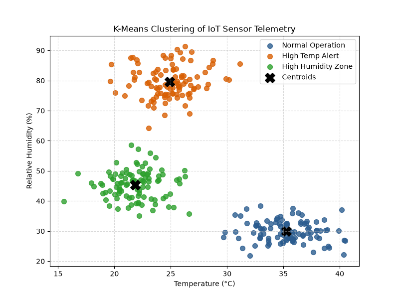
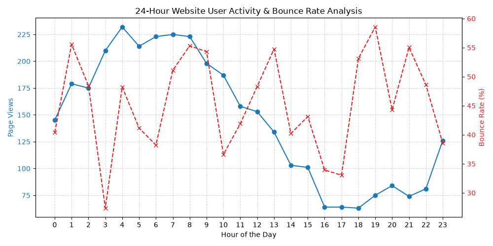

# IoT Sensor Clustering & Web Traffic Analytics

A data analytics and unsupervised machine learning project built in **Python** using `Pandas`, `Scikit-Learn`, and `Matplotlib`.

## Overview
This repository contains two core modules:
1. **Website User Activity Analytics:** Processes time-series web traffic logs to evaluate hourly page views and bounce rate correlations.
2. **IoT Sensor Telemetry Clustering:** Implements the **K-Means Clustering** algorithm with feature standardization (`StandardScaler`) to classify environmental IoT sensor readings (Temperature & Humidity) into distinct operational zones and detect anomalies.

## Visualizations & Results

### 1. K-Means Clustering of IoT Sensor Telemetry


### 2. 24-Hour Website User Activity & Bounce Rate Analysis


## Tech Stack
* **Language:** Python 3.x
* **Libraries:** `pandas`, `numpy`, `scikit-learn`, `matplotlib`

## How to Run
```bash
pip install numpy pandas matplotlib scikit-learn
python analytics_pipeline.py